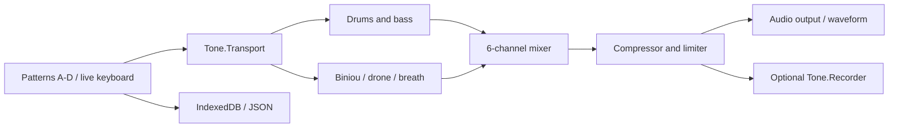

# NikoGroove — Cyber-Fest-Noz V2 · Studio Niko Design

**A browser-based EBM/Breizh groovebox combining electronic drums, acid bass and a synthesized biniou.**

Un laboratoire sonore qui fusionne l'esthétique industrielle de l'EBM et les timbres de la musique bretonne.

   

**STUDIO NIKO DESIGN** · Build smart. Stay lightweight. Create without limits.

[English overview](#english-overview) · [Démarrage rapide](#quickstart--démarrage-rapide) · [Issues](https://github.com/Nikoju1977/nikogroove/issues)

> [Insérer ici un GIF de démonstration / Insert demo GIF here]

> **Statut : variante historique, non sélectionnée dans la vitrine.** [Projet de référence EBM-BRETONNE.](https://github.com/Nikoju1977/EBM-BRETONNE.)

## Pourquoi ce projet ?

Explorer le croisement entre musique de danse électronique et ornementation bretonne dans un instrument compact. Tone.js fournit le transport et les primitives de synthèse ; l'interface JavaScript reste intégrée au document HTML, sans chaîne de compilation.

## Fonctionnalités clés

- 🥁 Séquenceur 16 pas avec patterns A–D et chaînage.
- 🎹 Piano roll de basse et de biniou, clavier tactile, transposition et ornements.
- 🌬️ Biniou numérique : double voix, souffle synthétique, vibrato, portamento, bourdon et modulation.
- 🎛️ Six voies (kick, snare, hat, bass, biniou, drone), mute/solo, compresseur et limiteur.
- 💾 Historique undo/redo des patterns, sauvegarde IndexedDB avec repli en mémoire et export/import JSON.
- 🔴 Capture master par Tone.Recorder si MediaRecorder est disponible ; format dépendant du navigateur, pas de promesse de WAV PCM.

## Architecture & sécurité



Le graphe de `index.html` utilise `Tone.MembraneSynth`, `NoiseSynth`, `MetalSynth`, `MonoSynth`, `DuoSynth`, oscillateurs et LFO. Le biniou est une interprétation synthétique, pas un enregistrement ni un modèle physique validé. Le transport est assuré par Tone.js 14.8.49 chargé via CDN ; Google Fonts utilise également le réseau. Le traitement audio est local après chargement des ressources. IndexedDB et JSON ne sont pas chiffrés ; le repli en mémoire peut disparaître à la fermeture. Aucun fonctionnement intégral hors ligne, PWA installable ou export MIDI/WAV n'est revendiqué.

**Preuves :** inspection du code source et des documents sur GitHub. Aucun test audio, benchmark, écoute ni validation de production nouvelle lors de cette révision documentaire. Les contrôles antérieurs rapportés ci-dessous ne prouvent pas la stabilité actuelle sur appareils physiques.

## Quickstart / Démarrage rapide

Servir le dépôt avec `python3 -m http.server 8000`, ouvrir http://localhost:8000/, attendre le chargement de Tone.js et activer le moteur audio. Programmer un pattern, activer la lecture, exporter le projet JSON pour une sauvegarde indépendante.

## Documentation technique et historique

> **Statut portfolio (octobre 2026) — variante conservée, non sélectionnée dans la vitrine.** La version de référence retenue pour la groovebox Cyber-Fest-Noz est EBM-BRETONNE. Cette variante reste consultable pour préserver son historique et comparer les évolutions. Voir [la politique de sélection](https://github.com/Nikoju1977/Nikoju1977/blob/main/CURATION.md) et [le projet de référence](https://github.com/Nikoju1977/EBM-BRETONNE.).


**Catégorie : musique électronique & création sonore** · Studio Niko Design

Expérimentation de groovebox EBM / Breizh fonctionnant dans le navigateur. Le document principal `index.html` affiche « Cyber-Fest-Noz V2 — Groovebox EBM Breizh ». Le dépôt contient également `index.v1.html`, version antérieure.

## Lancer le projet

```bash
python3 -m http.server 8000
```

Ouvrir http://localhost:8000/ dans un navigateur récent, ou ouvrir directement `index.html` si les restrictions du navigateur le permettent.

## Dépendances et fonctionnement

L'interface et la logique sont embarquées dans les fichiers HTML. Le moteur sonore **Tone.js** est chargé par CDN et les typographies proviennent de Google Fonts : le projet n'est pas totalement autonome hors connexion. Le navigateur peut exiger un clic ou un toucher avant la lecture audio.

## Organisation du dépôt

- `index.html` — expérience principale.
- `index.v1.html` — version conservée.
- `.github/workflows/` — automatisations GitHub éventuelles.

## Positionnement

Projet **créatif et expérimental**, sans promesse de stabilité sur tous les appareils. Les ressemblances avec [EBM-BRETONNE.](https://github.com/Nikoju1977/EBM-BRETONNE.) méritent d'être évaluées avant toute fusion ou suppression : les historiques sont conservés séparément.

[Voir tous les projets classés par thème](https://github.com/Nikoju1977).

## Roadmap & contribution

Propositions non terminées :

- [ ] Comparer les fonctions et les différences de V1, V2 et EBM-BRETONNE sans fusionner les historiques.
- [ ] Valider Tone.Recorder et les formats de capture sur les navigateurs cibles.
- [ ] Documenter la latence, la charge CPU et le comportement du clavier tactile.
- [ ] Évaluer un hébergement local de Tone.js et des polices avec leurs licences.

**Première contribution / `good first issue` (label proposé, non créé ici) :** Documenter une variation de timbre ou un défaut de séquençage reproductible et préciser la version du navigateur. Les retours sont bienvenus dans les [issues](https://github.com/Nikoju1977/nikogroove/issues), sous réserve des droits existants. Ne pas partager de données ou sons privés.

## English overview

NikoGroove is an experimental EBM/Breizh groovebox: four 16-step patterns, six mixer channels, synthesized drums, bass, biniou, drone and breath. Tone.js is an actual runtime dependency, loaded from a CDN. Local project storage and JSON exports are available; browser-dependent master recording is optional. The repository remains a historical variant, not the flagship Cyber-Fest-Noz release. See EBM-BRETONNE for the curated reference project. No fresh runtime test or performance benchmark was run during this documentation revision. Feedback and reproducible issue reports are welcome; respect the existing rights notice.

## Licence & auteur / License & author

**© 2026 Studio Niko Design — [Nikoju1977](https://github.com/Nikoju1977).** [Notice de droits d'auteur](LICENSE.md) : tous droits réservés pour les contributions originales concernées ; Tone.js et les autres ressources tierces conservent leurs licences propres. Aucun fichier de licence n'est modifié.
